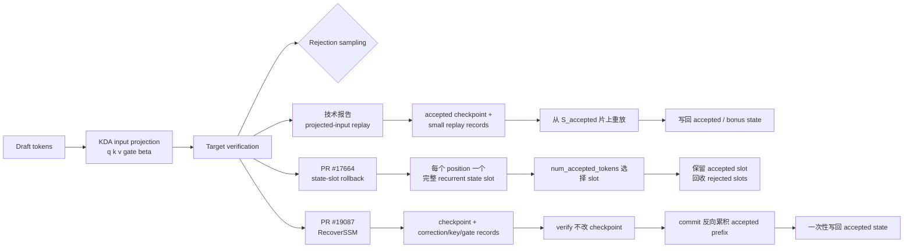
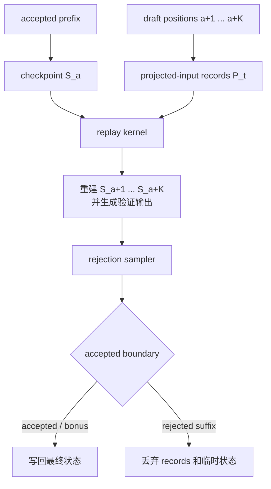
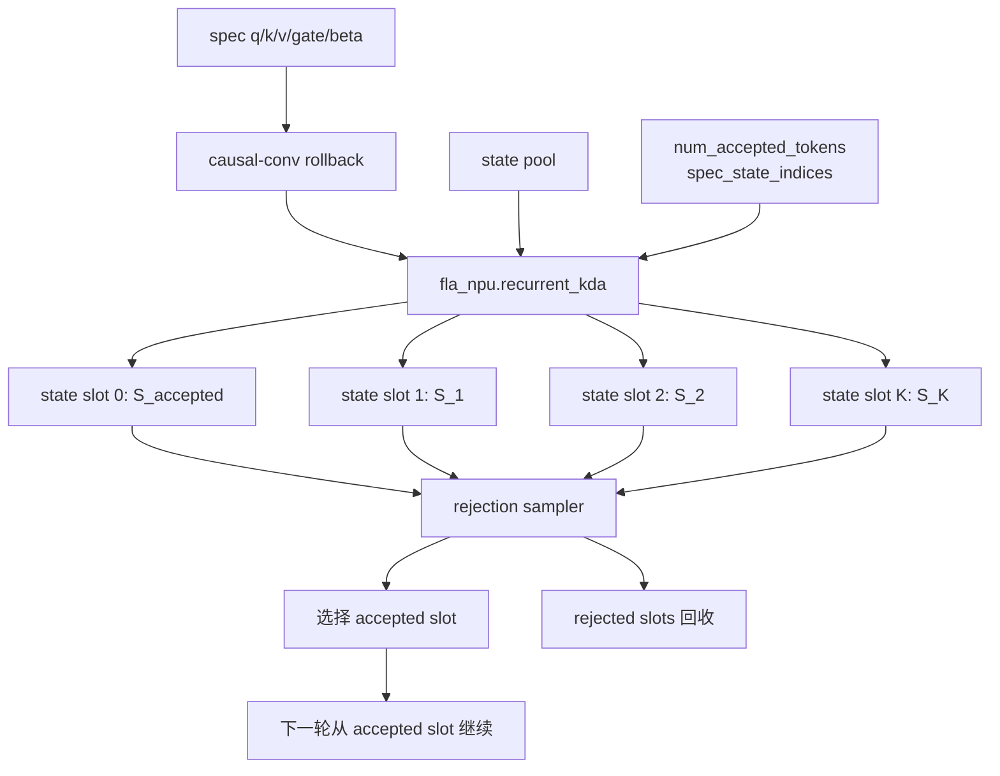
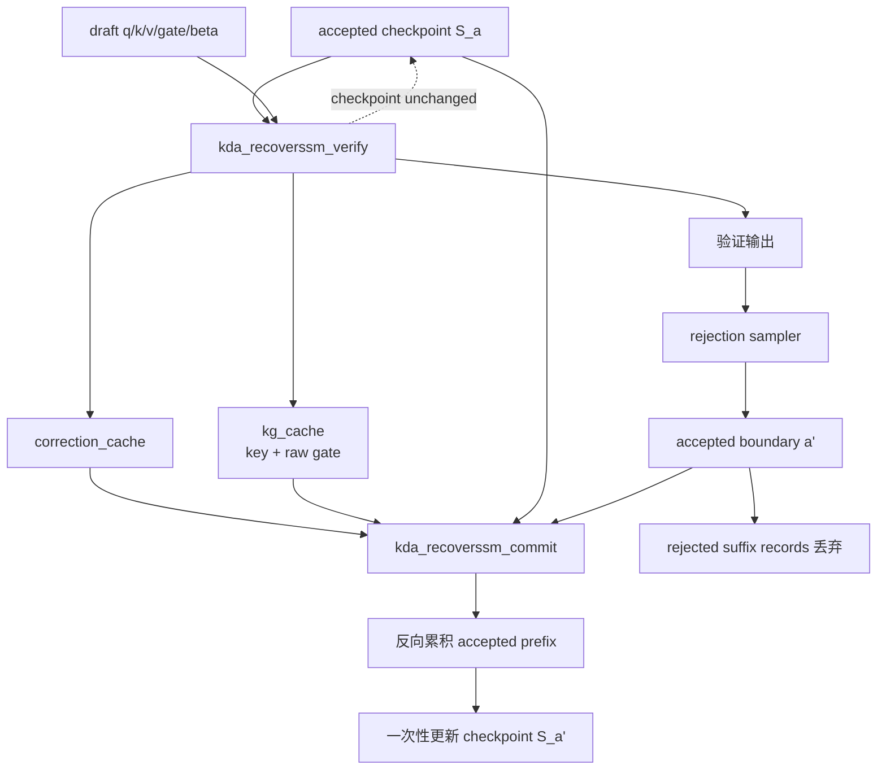
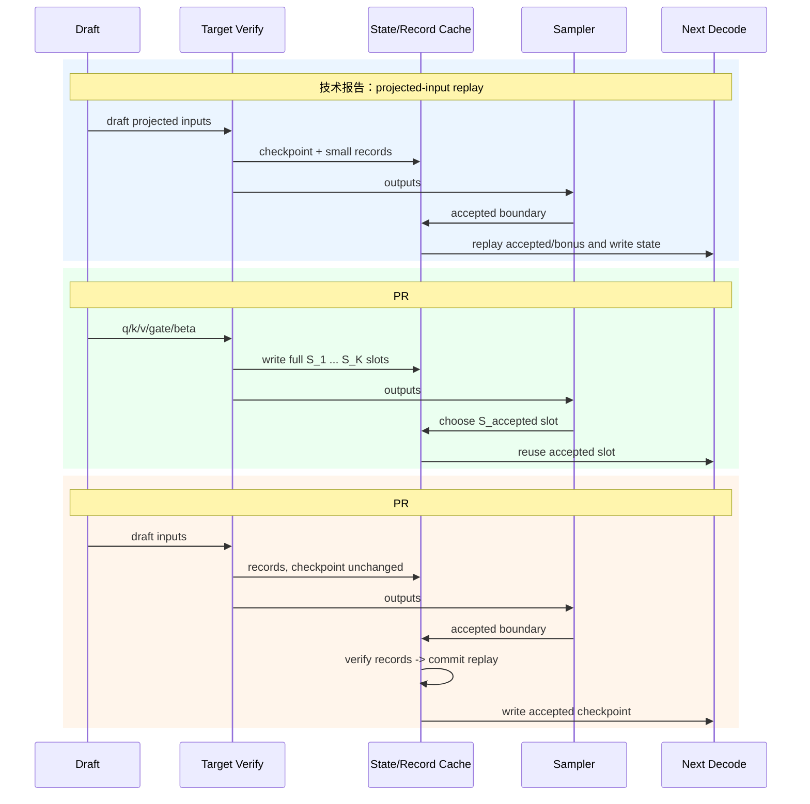
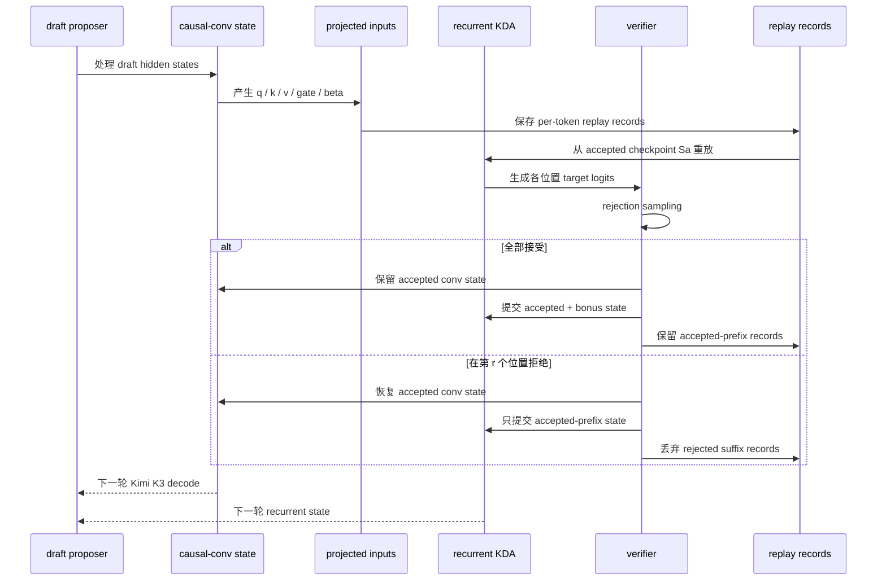
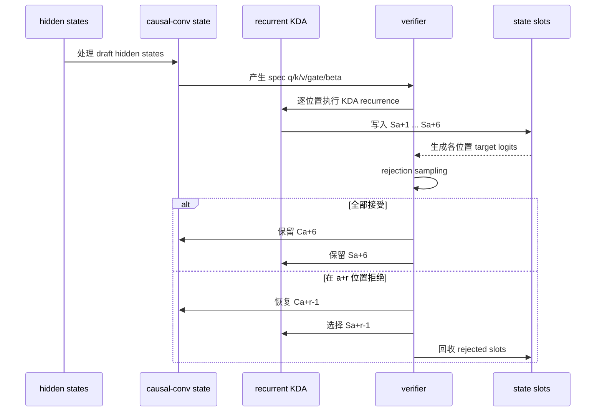
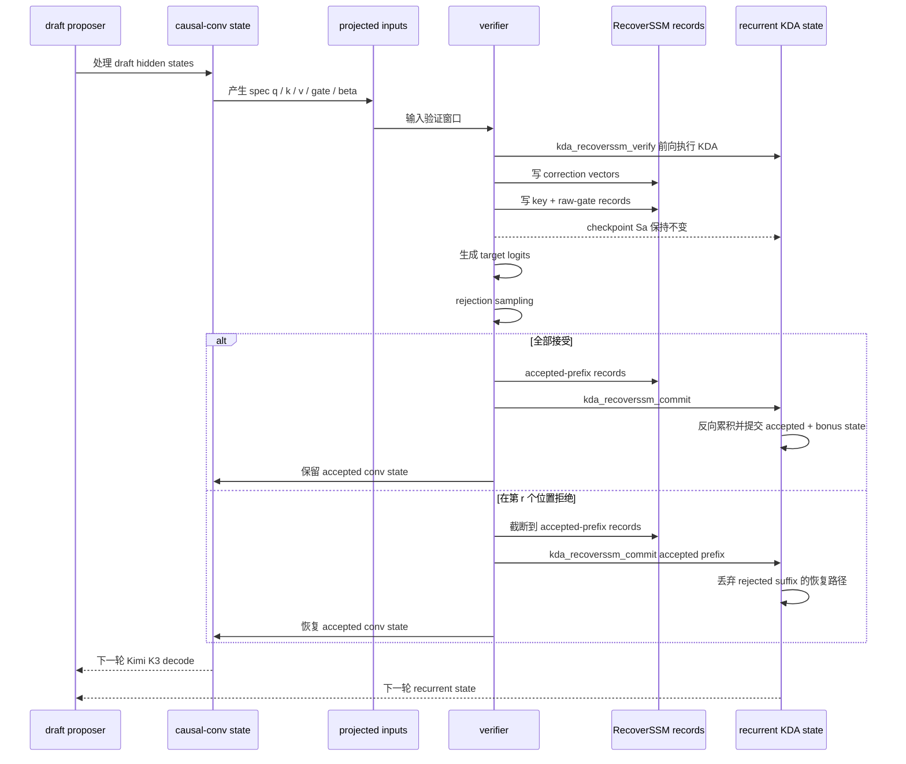

# Kimi K3 投机推理：技术报告、PR #17664 与 PR #19087

## 结论

| 方案 | 核心机制 | recurrent state 处理 | 定位 |
|---|---|---|---|
| 技术报告 | RecoverSSM / projected-input replay | 保存可重建状态的较小记录，从 accepted checkpoint 重放 | 目标方案 |
| PR #17664 | fla_npu recurrent KDA | 每个 speculative position 使用 state slot | 算子替换 + state-slot rollback |
| PR #19087 | Ascend Triton RecoverSSM verify/commit | 保存 correction vectors、key/raw-gate records，最后提交 accepted 状态 | 技术报告方案的实验性原型 |

PR #19087 的主要增益不是改变 KDA 数学公式，而是改变状态保存方式：从每个位置保存完整 recurrent state，变成保存可重建状态的压缩记录。它已经接近技术报告的算法思想，但仍是 Draft/V1 Archive 原型，不是完整生产级 fused replay 实现。

## 第一章：投机回滚

本章统一说明技术报告、PR #17664、PR #19087 的回滚机制、状态生命周期、显存/访存收益和 Kimi K3 的回滚架构。

### 三种投机回滚方案总览

三种方案的共同输入都是目标模型对投机窗口产生的 KDA 投影输入；差别在于验证阶段如何保存中间状态，以及 rejection sampling 后如何恢复 accepted prefix。



### 方案 A：技术报告 projected-input replay



核心特点是只保留一个 accepted-prefix checkpoint 和小型 per-token records，不保存每个 draft position 的完整 recurrent state。技术报告还设想将短卷积、输入归一化、gate、recurrent KDA 和输出归一化融合到同一个 replay kernel。

### 方案 B：PR #17664 state-slot rollback



该方案将每个 speculative position 的完整状态写入独立 slot。它已经形成可用的功能闭环，但 state pool 容量和 state writeback 随窗口长度增加。

### 方案 C：PR #19087 RecoverSSM verify/commit



该方案把验证和提交分开：verify 阶段不污染主 checkpoint；确定 accepted boundary 后，commit 只重建并写回 accepted/bonus 状态。

### 三种方案的状态生命周期对比



### 技术报告方案

技术报告中的 KDA 递推可写为：

\[
S_t=M_tS_{t-1}+\beta_t k_t v_t^\top,
\qquad
M_t=(I-\beta_t k_t k_t^\top)\operatorname{Diag}(\alpha_t),
\]

\[
\tilde{o}_t=S_t^\top q_t.
\]

给定 accepted prefix 末端状态 S_a，后续状态完全由 draft token 的投影输入决定：

\[
S_{a+i}=F(S_{a+i-1},P_{a+i}).
\]

其中 P_t 是生成 KDA 递推所需的 key/value/gate/beta 等 per-token 记录。技术报告的 replay 流程是：

    保留 accepted prefix checkpoint S_a
    缓存 draft token 的小型 projected-input / replay records
    从 S_a 片上重放验证链
    只写回 verified token 和 bonus token 的状态

报告还设想将短卷积、输入归一化、gate、KDA recurrence 和输出归一化放入同一 fused kernel。不能仅凭 PR #19087 的 verify/commit primitive 认定这个 fused kernel 已全部实现。

### PR #17664：state-slot rollback

PR [#17664](https://github.com/vllm-project/vllm-ascend/pull/17664) 于 2026-10-04 合并。它把 Kimi K3/GLM5Next 使用的 chunk_kda_fwd、recurrent_kda 切换到 fla_npu.ops.ascendc，保留 gate/beta、V-first state 和 speculative metadata。

它依赖 num_accepted_tokens、spec_state_indices、spec_query_start_loc，且 causal-conv 与 recurrent KDA 共用 accepted prefix 语义。

工作方式近似为：

    slot 0：accepted prefix 末端状态
    slot 1：第一个 speculative position 的状态
    slot 2：第二个 speculative position 的状态
    ...

验证后选择 accepted slot，拒绝 token 的状态留在独立 slot 中。因此 17664 是功能正确的状态槽快照恢复方案，解决了状态污染，但仍为 speculative positions 保留完整大 state。

PR 报告 A5 recurrent KDA 121.810 -> 94.639 微秒（-22.31%），A3 81.573 -> 83.999 微秒（+2.97%）；这是算子/集成 profile，不等于投机服务吞吐提升。

### PR #19087：RecoverSSM verify/commit

PR [#19087](https://github.com/vllm-project/vllm-ascend/pull/19087) 增加两个 primitive。

kda_recoverssm_verify：读取 accepted prefix checkpoint，沿验证链前向执行 KDA，生成输出，保存 FP32 correction vectors 和 activation-dtype 的 key/raw-gate records，并保持原 checkpoint 不变。

kda_recoverssm_commit：得到 rejection sampling 的 accepted 边界，从最后接受位置反向累积 accepted prefix，一次性更新原始 checkpoint，不读取 rejected suffix records。

其记录结构为：

    checkpoint_state[blocks, heads, value_dim, key_dim]
    correction_cache[blocks, heads, capacity, value_dim]
    kg_cache[blocks, heads, capacity, 2 * key_dim]

它不是简单复制 q/k/v/g/beta，而是保存足以重建 accepted state 的压缩递推记录。

### 19087 相较 17664 的增益

1. 状态容量从每个 speculative position 的完整矩阵变成一个 checkpoint 加小型 records。
2. 验证期间不修改主 checkpoint，rejected suffix 只是临时 records。
3. 显式拆成 verify/commit，并通过记录重建 accepted 状态，更接近报告的 replay 思路。
4. 代价是额外计算和搬运。PR 自己的 batch=32 微基准中，RecoverSSM verify+commit 约 121 微秒，而 AscendC verify 约 51--54 微秒。当前增益主要是状态容量和流量潜力，不是已证明的端到端 TPOT 加速。

### K=5、6 个验证位置的显存核算

只计算 KDA recurrent state 和 RecoverSSM records，不计算 causal-conv、attention KV、padding、allocator alignment、scratch 之外激活、多层多头复制。按每个 local head，假设 head_dim=128、FP32 state、BF16 records。

一个 recurrent state：

\[
B_S=128\times128\times4=65{,}536\text{ bytes}=64\text{ KiB}.
\]

PR #17664 对 6 个位置：

\[
B_{17664}=6B_S=384\text{ KiB}.
\]

这与 PR #19087 描述中的 FP32 baseline 一致。

PR #19087 对相同配置给出的 logical RecoverSSM records：

\[
B_{19087}=70\text{ KiB per head}.
\]

因此：

\[
\Delta B=384-70=314\text{ KiB per head},
\]

\[
\text{节省比例}=1-70/384=81.77\%,
\qquad
70/384=18.23\%.
\]

单 local head 的逻辑 recurrent 存储从 384 KiB 降到约 70 KiB。

70 KiB 不能用简单的 6 × (key + gate) 复算：correction_cache 按 value dimension 保存 correction vectors，kg_cache 按 2 * key_dim 保存 key/raw-gate，实际 capacity 和记录布局也参与计算。该数字是 PR 给出的完整 logical tensor-size 结果；它不代表 allocator 会立即缩容，因为 19087 保留 native cache allocation 并增加 scratch。

### 访存核算

显存容量和实际 NPU DRAM traffic 不是同一个指标。采用每条记录一次写入、一次读取的对称逻辑模型：

\[
T_{17664}=2\times384=768\text{ KiB},
\]

\[
T_{19087}=2\times70=140\text{ KiB},
\]

\[
\Delta T=768-140=628\text{ KiB},
\qquad
\text{估算节省}=81.77\%.
\]

这只是 record traffic 的模型化估算。真实流量会受 accepted slot 是否只读一个 state、19087 的 checkpoint/records/scratch 读写、tile/padding、连续性、cache 命中和 kernel 融合影响。因此 81.77% 不是实测 DRAM 降幅，需要采集 NPU memory read/write bytes 和 state-pool transaction counters 才能确认。

### 限制

PR #19087 是 Draft/V1 Archive，默认关闭；要求 MRV1、MTP、eager、同步调度、PP=1、DP=1；不支持 graph/async、prefix caching、KV transfer；保留原生 state allocation；当前 verify+commit 慢于 AscendC baseline；没有把报告所述全部阶段融合成生产级 replay kernel。

PR #17664 已合并，可作为当前 KDA recurrent 执行路径，但仍是 state-slot rollback，state traffic 随 speculative position 数增加。

### 最终判断

    K=5，验证窗口=6，head_dim=128，按每个 local head：
    PR #17664 state-slot：384 KiB
    PR #19087 RecoverSSM：70 KiB
    逻辑显存减少：314 KiB
    逻辑显存节省：81.77%

    对称一次读 + 一次写模型：
    PR #17664：768 KiB
    PR #19087：140 KiB
    逻辑 record traffic 减少：628 KiB
    估算节省：81.77%

PR #19087 的本质增益是：把 KDA speculative rollback 从“保存每个位置的完整 recurrent state”推进到“保存可重建状态的压缩记录，并在 accepted boundary 之后 commit”。它体现了技术报告 RecoverSSM 的核心思想，但距离完整 fused projected-input replay 和生产级 serving integration 仍有差距。

### 增益计算的详细解释：不是普通 attention KV Cache

这里的“节省 KV Cache”需要准确表述为：**节省 KDA speculative rollback 所需的 recurrent state cache**。它不是普通 softmax/MLA attention 的 token-level KV Cache。PR #19087 的逻辑容量数字也排除了 attention KV、causal-conv state、padding 和 allocator alignment。

### PR #17664 的 state-slot 容量

KDA 每个 recurrent state 是一个矩阵：

\[
S_t\in\mathbb{R}^{V\times K}.
\]

假设 `head_dim=128`、value 维度也是 128、state 使用 FP32，则单个 state 大小为：

\[
B_S=128\times128\times4
=65{,}536\text{ bytes}=64\text{ KiB}.
\]

当 speculative K=5、验证窗口包含 leading target token 时，共有：

\[
K+1=6
\]

个位置。PR #17664 的 state-slot 方案需要：

\[
B_{17664}=6\times64=384\text{ KiB per local head}.
\]

Kimi K3 [`config.json`](https://huggingface.co/moonshotai/Kimi-K3/blob/main/config.json) 中共有 93 个 hidden layers，其中 `kda_layers` 为 69 层，`num_heads=96`，`head_dim=v_head_dim=128`。以下只计算 **1 个请求**，不包含 causal-conv state、MLA attention KV、workspace、padding 和 allocator 对齐。

TP=1 时每层使用 96 个 heads：

\[
B_{17664,\text{K3},\text{TP1}}
=384\text{ KiB}\times69\times96
=2{,}543{,}616\text{ KiB}
\approx2{,}484\text{ MiB}
\approx2.426\text{ GiB}.
\]

若按常见 TP=8 部署，每个 rank 的 local heads 为 \(96/8=12\)：

\[
B_{17664,\text{K3},\text{TP8/rank}}
=384\text{ KiB}\times69\times12
=317{,}952\text{ KiB}
\approx310.5\text{ MiB}.
\]

因此，Kimi K3 在 K=5、FP32 recurrent state、单请求下，PR #17664 的 state-slot 逻辑容量为 **2.426 GiB（TP1）**，或 **310.5 MiB/每卡（TP8）**。实际分配还会受到 TP/PP 分片、slot capacity、padding 和对齐影响。

### PR #19087 的 RecoverSSM 容量

RecoverSSM 不为六个位置保存六个完整的 \(128\times128\) state，而是保存：

- 一个 accepted-prefix checkpoint；
- correction vectors；
- key/raw-gate records。

PR #19087 对“五个 speculative token、六个 verified positions、FP32 state”的配置给出的 logical record 大小为：

\[
B_{19087}=70\text{ KiB per local head}.
\]

因此：

\[
\Delta B=384-70=314\text{ KiB per local head},
\]

\[
\text{Saving}=1-\frac{70}{384}=81.77\%,
\qquad
\frac{70}{384}=18.23\%.
\]

也就是说，RecoverSSM 记录约为 state-slot 方案的 18.23%。对 Kimi K3，使用同样的 69 个 KDA 层和 96 个 heads，只计算 1 个请求：

TP=1 时：

\[
B_{19087,\text{K3},\text{TP1}}
=70\text{ KiB}\times69\times96
=463{,}680\text{ KiB}
\approx452.8\text{ MiB}
\approx0.442\text{ GiB}.
\]

TP=8 时每个 rank 有 12 个 local heads：

\[
B_{19087,\text{K3},\text{TP8/rank}}
=70\text{ KiB}\times69\times12
=57{,}960\text{ KiB}
\approx56.6\text{ MiB}.
\]

对应的 Kimi K3 单请求逻辑节省为：

\[
\Delta B_{\text{TP1}}
=2{,}543{,}616-463{,}680
=2{,}079{,}936\text{ KiB}
\approx1.984\text{ GiB},
\]

\[
\Delta B_{\text{TP8/rank}}
=317{,}952-57{,}960
=259{,}992\text{ KiB}
\approx253.9\text{ MiB}.
\]

节省比例仍为：

\[
1-\frac{70}{384}=81.77\%.
\]

这里的 70 KiB 是 PR #19087 给出的每 local head logical RecoverSSM record 容量，不能简单按六次 `key + gate` 重新推导，因为 correction vectors、key/raw-gate records、capacity 和布局都参与其中。

此前的通用表达式若保留请求数变量应写成：

\[
\Delta B_{total}=314\text{ KiB}\times L\times H\times R,
\]
但本节 Kimi K3 结果固定为单请求 \(R=1\)。

### 显存容量与访存量的区别

显存容量可以直接比较 384 KiB 和 70 KiB；访存量还取决于记录的读写次数。用“一次写入 + 一次读取”的对称模型估算：

\[
T_{17664}=2\times384=768\text{ KiB},
\]

\[
T_{19087}=2\times70=140\text{ KiB},
\]

\[
\Delta T=768-140=628\text{ KiB},
\qquad
\text{estimated saving}=81.77\%.
\]

这不是实际 NPU DRAM traffic 的保证值。17664 下一轮可能只读取 accepted slot；19087 还要读取 checkpoint、写入和读取 records、执行 commit，并可能产生 scratch/gather/writeback。真实结果需要采集 NPU memory read/write bytes、kernel duration 和 state-pool transaction counters。

### 不应表述为“整个 KV Cache 减少 81.77%”

需要把“KV Cache”拆成普通 MLA attention KV 和 KDA speculative rollback cache。以下使用 Kimi K3 `config.json`，按 TP=1、单请求、验证窗口 6 个位置计算。配置中有 24 个 `full_attn_layers`，`kv_lora_rank=512`，`qk_rope_head_dim=64`，模型 dtype 为 BF16。

普通 MLA attention 的每个 token、每个 full-attention layer 的缓存元素数为：

\[
D_{\text{MLA-KV}}=512+64=576.
\]

BF16 每个元素 2 bytes，因此 6 个验证位置的普通 attention KV 为：

\[
B_{\text{MLA-KV}}
=6\times24\times576\times2
=165{,}888\text{ bytes}
=162\text{ KiB}.
\]

这部分在 PR #17664 和 PR #19087 中都需要，RecoverSSM 不会减少它，因此：

\[
\Delta B_{\text{ordinary KV}}=0.
\]

上述 162 KiB 采用 Kimi K3 MLA 的压缩 KV 表示（`kv_lora_rank + qk_rope_head_dim`）。如果某个后端把 full-attention 的 K/V 展开为 `96 heads × 128 dim × 2(K/V)`，同样 6 个位置、24 层的普通 KV 会是 6.75 MiB；这仍然是两种方案共同承担的缓存，节省量仍只来自 KDA rollback cache。

KDA 回滚缓存则是前面计算的：

\[
B_{17664,\text{KDA}}=2{,}543{,}616\text{ KiB},
\qquad
B_{19087,\text{KDA}}=463{,}680\text{ KiB}.
\]

将普通 MLA KV 也计入“投机窗口总逻辑缓存”：

\[
B_{17664,\text{all}}
=2{,}543{,}616+162
=2{,}543{,}778\text{ KiB}
\approx2.42594\text{ GiB},
\]

\[
B_{19087,\text{all}}
=463{,}680+162
=463{,}842\text{ KiB}
\approx0.44235\text{ GiB}.
\]

因此合并后的逻辑节省为：

\[
\Delta B_{\text{all}}
=2{,}543{,}778-463{,}842
=2{,}079{,}936\text{ KiB}
\approx1.984\text{ GiB},
\]

\[
\text{saving}
=1-\frac{463{,}842}{2{,}543{,}778}
\approx81.766\%.
\]

因此，加入普通 MLA KV 后，理论比例仍约为 **81.77%**，原因是 162 KiB 的普通 KV 相对于 Kimi K3 的 KDA recurrent state 很小；但严格表述应为：

```text
普通 MLA attention KV：节省 0%
KDA speculative rollback cache：节省约 81.77%
两者合计的投机窗口逻辑缓存：节省约 81.766%
causal-conv state、scratch、padding 和 allocator 对齐：未计入
实际进程显存：不一定按该比例下降
```

PR #19087 当前保留原生 serving cache allocation，并额外使用 scratch，因此上述结果是逻辑缓存容量比较，不能直接等同于整个服务进程的实际显存读数。


## 技术报告与 PR #19087：Kimi K3 投机验证完整流程

以下两张图只关注投机回滚本身。两种方案共享 draft 生成、目标 Kimi K3 前向、causal-conv、projected inputs、recurrent KDA、logits 计算和 rejection sampling；差别在于 speculative recurrent state 的保存与 accepted boundary 之后的提交方式。

### 技术报告方案：projected-input replay



技术报告方案不为每个 speculative position 保存完整 recurrent state，而是保存能够重建递推的 projected-input / replay records。验证期间从 accepted checkpoint 重放；rejection sampling 确定边界后，只提交 accepted prefix 和 bonus position。causal-conv state 也必须恢复到同一个 accepted boundary。

### PR #17664：state-slot rollback 完整前向流程



该图表示 PR #17664 的核心语义：验证窗口中每个位置都把完整 recurrent state 写入独立 slot；rejection sampling 确定 accepted boundary 后，选择对应的 state slot，并将 rejected slots 标记为可复用。causal-conv state 必须同步恢复到同一 accepted boundary。

### PR #19087：RecoverSSM verify / commit



PR #19087 在 verify 阶段不修改 accepted checkpoint (S_a)，而是保存 correction、key 和 raw-gate 等记录。rejection sampling 得到 accepted boundary 后，commit 只恢复 accepted prefix；rejected suffix records 被丢弃。该方式用 records、反向恢复和 commit 计算，减少每个 speculative position 的完整 recurrent state 保存。

### 两种流程的共同因果边界

```text
draft token ids
      ↓
target K3 前向：causal-conv → q/k/v/gate/beta → recurrent KDA → logits
      ↓
rejection sampling：确定 accepted boundary
      ↓
同步恢复 causal-conv state 与 recurrent KDA state
      ↓
从 accepted prefix 进入下一轮
```

不能只恢复 KDA state 而保留 rejected suffix 的 causal-conv state；否则下一轮生成的 q/k/v/gate/beta 会携带被拒绝 token 的历史。

